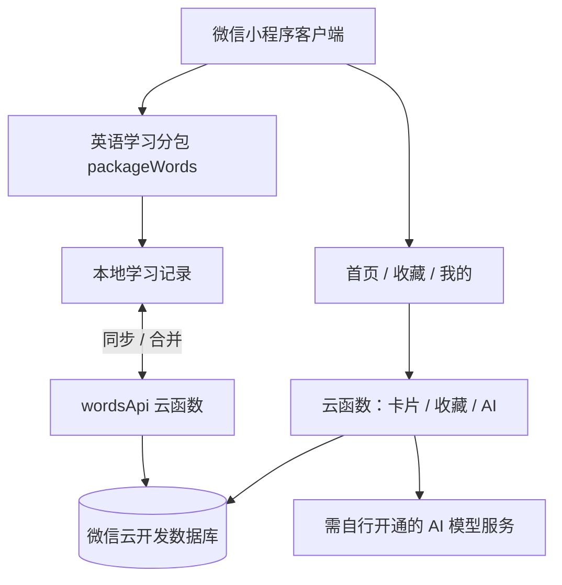

<div align="center">

# ✨ 拾光 · Shiguang

**每天一点灵感，每天一点进步。**

一个由两位开发者合作完成的微信小程序：灵感卡片、AI 创作、英语单词学习与每日打卡。

[](LICENSE)
[](https://developers.weixin.qq.com/miniprogram/dev/framework/)
[](https://github.com/liujiayiwzl/shiguang-miniapp-open-source/actions/workflows/ci.yml)
[](https://github.com/liujiayiwzl/shiguang-miniapp-open-source/stargazers)

**[📱 微信用户：使用线上拾光](docs/EXPERIENCE.md)** · **[💻 开发者：部署开源版](docs/DEVELOPMENT.md)** · **[🐛 提交问题](https://github.com/liujiayiwzl/shiguang-miniapp-open-source/issues/new/choose)**

</div>

---

> **先说明：本仓库是开源演示版，不是正在运营的拾光生产环境。**
> 本仓库不包含真实 AppID、云开发环境 ID、用户数据或正式的 14,286 条词库；四个词库各提供 **12 条演示单词**。微信普通用户请使用已上线的小程序；开发者可以克隆源码，用自己的环境部署。
>
> **为什么 GitHub 页面没有“直接打开小程序”按钮？** 微信小程序不能直接作为 GitHub 网页运行。扫码进入微信线上版，或下载代码在微信开发者工具中运行。正式小程序码待维护者上传，详见 [线上体验指南](docs/EXPERIENCE.md)。

## ✨ 功能介绍

| 功能 | 体验内容 | 代码位置 |
| --- | --- | --- |
| 🎴 灵感卡片 | 随机抽取、主题卡片、中英文内容 | `pages/index/`、`cloudfunctions/getLibraryCard/` |
| 🤖 AI 创作 | 输入主题/关键词生成卡片；包含额度与内容审核逻辑 | `cloudfunctions/generateCard/` |
| ❤️ 卡片收藏 | 收藏、查看、取消收藏；分享支持受限卡片链接 | `pages/favorites/`、`cloudfunctions/favoritesApi/` |
| 📚 英语背词 | 初中、高中、四级、六级；翻卡背词、四选一练习 | `packageWords/pages/study/` |
| 📆 学习打卡 | 每日目标、学习记录、月历与正确率 | `packageWords/pages/history/` |
| ☁️ 云端同步 | 本地优先、断网降级、云端学习进度合并 | `utils/word-progress.js`、`cloudfunctions/wordsApi/` |

**AI 功能说明**：仓库保留了基于微信云开发的模型调用代码，但需要部署者自行开通可用服务、配置权限并承担相关费用；**生成内容不等于自动获准公开**。

## 📱 我只想使用已上线的拾光

**不用下载 GitHub 代码！** 用手机微信搜索小程序的正式上线名称，或扫描官方小程序码，即可进入正式版。

目前仓库暂未附上经核验的正式小程序码；维护者可以按 [《线上体验与小程序码》](docs/EXPERIENCE.md) 下载并添加图片。请勿拿开发版预览二维码、普通网页二维码冒充正式小程序码。

## 🚀 开发者快速开始

```bash
git clone https://github.com/liujiayiwzl/shiguang-miniapp-open-source.git
```

1. 安装 [微信开发者工具](https://developers.weixin.qq.com/miniprogram/dev/devtools/download.html)，导入克隆下来的项目目录。
2. 在 `project.config.json` 中将 `touristappid` 改为自己的 AppID（按开发者工具当前要求配置）。
3. 开通自己的微信云开发环境，在 `app.js` 中替换 `YOUR_CLOUDBASE_ENV_ID`。
4. 按 [部署指南](docs/DEVELOPMENT.md) 创建所需集合、部署云函数并配置必要服务。
5. 在开发者工具中编译与预览。四个演示词库均提供 12 条示例数据，用于验证交互流程。

**注意**：小程序首页卡片、AI 和收藏等依赖云函数；没有配置云环境时，不能期待这些功能全部正常使用。英语打卡模块设计了本地优先的降级能力。

## 🧪 自动化测试

不需要连接真实微信云开发，直接用 Node.js 运行现有的模拟数据库测试：

```bash
node scripts/test-words-api.js
node scripts/test-word-sync.js
```

每次推送与 Pull Request 会运行 GitHub Actions 自动测试，具体结果见页首 **Tests** 状态徽章。

## 🧱 技术架构



```text
.
├── pages/               # 首页 / 收藏 / 我的
├── packageWords/        # 英语单词分包与演示词库
├── components/          # 导航组件
├── cloudfunctions/      # 卡片、收藏、AI、学习记录等云函数
├── utils/               # 客户端业务工具
├── scripts/             # 数据构建脚本与模拟环境测试
├── docs/                # 使用、部署和展示说明
└── .github/             # 问题反馈、PR 模板与自动化测试
```

## 📸 项目截图

目前**尚未上传经确认的线上界面截图**。为了保证展示真实，不使用 AI 伪造产品运行截图。项目维护者可按照 [截图与展示素材指南](docs/SCREENSHOTS.md) 添加首页、背单词、打卡和收藏页面截图。

## 🔐 隐私、版权与开源范围

- 源代码脱敏后公开；**原线上仓库、私有 Git 历史、真实用户数据不公开**。
- 公开词库为少量演示数据；正式词库来源涉及第三方许可，不能将其视为 MIT 授权的自由数据。详见 [THIRD_PARTY_NOTICES.md](THIRD_PARTY_NOTICES.md)。
- 使用者需要自行承担 AppID、云资源、模型费用、安全审核、隐私合规和平台上线审核责任。
- 自有源码以 [MIT License](LICENSE) 授权。参与的两位开发者应确认开源授权与贡献署名；第三方内容仍遵守其各自许可。

## 🤝 参与项目

欢迎 [报告 Bug / 提功能建议](https://github.com/liujiayiwzl/shiguang-miniapp-open-source/issues/new/choose)、Fork 和提交 Pull Request。请阅读 [CONTRIBUTING.md](CONTRIBUTING.md) 与 [SECURITY.md](SECURITY.md)，勿在 Issue 中公开隐私或密钥。

---

<div align="center">

由两位独立开发者共同构建 · [GitHub 项目首页](https://github.com/liujiayiwzl/shiguang-miniapp-open-source)

如果这个项目对你有帮助，欢迎点一个 ⭐ Star。

</div>
